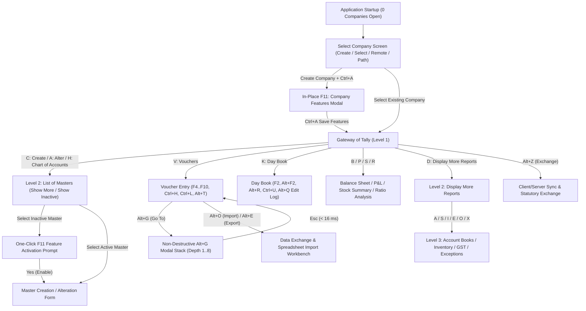
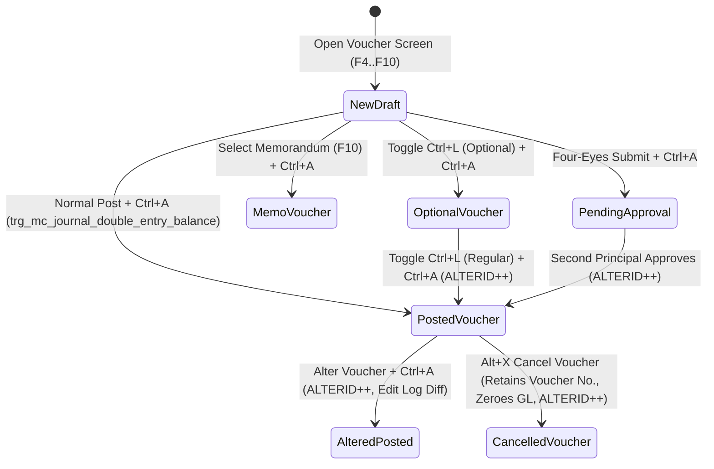
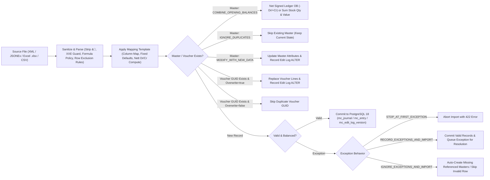

# Business Flow & Navigation Specification (`BUSINESS_FLOW.md`) — TallyPrime Gold Release 7.2 (`v1.1.7.2`)

- **Document ID**: `MC-TALLYPRIME-GOLD-BUSINESS-FLOW-V2.2`
- **Source Evidence**: `craft-anything-windows` static inspection of `C:\Program Files\TallyPrime\tally.exe` (`fnd_10`: `ev_91e9105873d9bc273279bd30d3fbcbbcad958a726bb221dad17c595ddd9a3774`, `ev_36869dbd0e9868d761d5332bb37055f6ba8db38f9f7629ab7508fd48ea87814d`, `ev_8ab28d93da36752aa179108f8d8f720704ac83a790dc863ec2a9a542e13c9735`, `ev_c6828d686cf47bc49df27ee62c0faec5d34bc78463069e7c0fa00dff1cabe50e`, `ev_f7a937d2b843a79b460968c57ea974acce8e7c444fcda31f45c06ece2ef71f49`, plus `ev_f30da517c3e069e2c23dd4e589d4b1cdaccb4b73e9b90cd40a4491cc49e71aa3`, `ev_99e6c5bbca31b776a2efccfe723270008f0beb8e380e7126a9a3958637c922fd`, `ev_4ed25bc08989daa711353bd15fef9ec20ee18a35c52ae0a67013f6a2ccf1b459`, `ev_734c89ddf139bb91ccf1e978face7978d2ed6bb61bc0646298f13192bc6aaf27`), `tally.ini` (`ev_960be990b38db33f04233eb35b17f1647eaf118b7f04925a7bc14e5849a0d8a1`), and **127** live Windows TallyPrime `1.1.7.2` Lab Oracles.

---

## 1. End-to-End Navigation & State Transition Architecture

---

## 2. Screen-by-Screen User Journeys & Keyboard Flows

### 2.1 Journey 1: Company Creation, `F11` Feature Progressive Disclosure & Multi-User Security Setup
1. **Startup (`0` Active Companies)**:
   - Operator shuts all open companies via `Ctrl+F3` (`Alt+K > Shut`) or launches with `0` companies selected.
   - Gateway renders **`Select Company`** (`[data-testid="windows-startup-select-company"]`).
2. **Create Company**:
   - Operator selects `Create Company`, enters `Company Name`, `Mailing Name`, `Address`, `State` (e.g., `Tamil Nadu`), `Country` (`India`), `Pincode`, `Financial year beginning from` (`2025-04-01`), `Books beginning from` (`2025-04-01`), `Base Currency Symbol` (`₹`), `Formal Name` (`INR`), `Number of decimal places` (`2`), and presses `Ctrl+A`.
3. **Automatic Post-Create `F11: Company Features` Modal**:
   - Immediately opens **`F11: Company Features`** with `Show more features` and `Show all features` toggles.
   - Operator configures `Accounting` (`Maintain Accounts`, `Enable Bill-wise entry`, `Enable Cost Centres`, `Enable Interest Calculation`), `Inventory` (`Maintain Inventory`, `Integrate Accounts with Inventory`, `Enable multiple Price Levels`, `Enable Batches`, `Maintain Expiry Date for Batches`, `Use Discount column in invoices`, `Use separate Actual and Billed Quantity columns in invoices`), `Taxation` (`Enable GST`, `Enable TDS`, `Enable TCS`), `Payroll` (`Maintain Payroll`, `Enable Payroll Statutory`), and `Audit` (`Enforce MCA Edit Log`).
   - Pressing `Ctrl+A` persists all 28 flags and transitions to **Gateway of Tally**.
4. **Multi-User Security & Role Assignment (`Alt+K > Security`)**:
   - Administrator assigns user grants (`COMPANY_ADMIN`, `SENIOR_ACCOUNTANT`, `AUDITOR_APPROVER`, `DATA_ENTRY_OPERATOR`, `INVENTORY_CLERK`, `READ_ONLY_VIEWER`) with optional per-user constraints:
     - `backdatedDaysLimit` (e.g., `7` days allowed for back-dated vouchers)
     - `voucherTypeAllowlist` (e.g., `["Sales", "Receipt"]`)
     - `exportPermitted` (`true` / `false`).

---

### 2.2 Journey 2: Master Creation, Alteration & Inline Secondary Creation (`Alt+C`)
1. **Gateway `Create` / `Alter` / `Chart of Accounts`**:
   - Operator presses `C` (`Create`), `A` (`Alter`), or `H` (`Chart of Accounts`) from Gateway.
   - Pressing **`Show More`** expands advanced masters (`Budget`, `Scenario`, `Credit Limits`, `Stock Category`, `GST Classification`); pressing **`Show Inactive`** reveals masters whose governing `F11` flag is currently `No` (`Cost Category`, `Cost Centre`, `Price Levels`, `Price List`, `Employee`, `Pay Heads`, `TCS Nature of Goods`) with `(Inactive — F11)` badges.
   - Selecting an inactive master opens the **One-Click Feature Activation Prompt** (*"Enable `<Feature>` in F11: Company Features now?"*); confirming enables the `F11` flag immediately and opens the master form.
2. **Inline Secondary Master Creation (`Alt+C`)**:
   - While typing inside any `<mc-typeahead-select>` cell in Voucher Entry or Master Creation, pressing **`Alt+C`** opens an inline modal for the target master (`Ledger`, `Stock Item`, `Account Group`, `UOM`, `Godown`).
   - Saving the inline modal (`Ctrl+A`) auto-selects the newly created master into the active cell and keeps keyboard focus in place.

---

### 2.3 Journey 3: Voucher Entry Workflows (`F4`–`F10`) & Posting State Machine

| Voucher Type | Shortcut | Default Entry Mode (`Ctrl+H`) | Posting Rule (`mc_entry` & Sub-Ledgers) |
| :--- | :--- | :--- | :--- |
| **Contra** | `F4` | `Single Entry` (`Account` + `Particulars`) | Transfers between `Cash-in-Hand`, `Bank Accounts`, `Bank OD/OCC` ledgers only. |
| **Payment** | `F5` | `Single Entry` | Credits header Cash/Bank (`Bank Allocations`); Debits Party (`Bill-wise`) / Expense (`Cost Centre`) lines. |
| **Receipt** | `F6` | `Single Entry` | Debits header Cash/Bank (`Bank Allocations`); Credits Party (`Bill-wise`) / Income lines. |
| **Journal** | `F7` | `Double Entry (As Voucher)` | Multi-line `Dr`/`Cr` (or `By`/`To` per `F12`) adjustment with auto-balanced residual amount on next row. |
| **Sales** | `F8` | `Item Invoice` | Debits Party (`New Ref` bill); Credits Sales Ledger(s) + Output `CGST`/`SGST`/`IGST` + `Round Off`; records `OUTWARD` inventory movement (`FIFO` / `Avg. Cost`). |
| **Purchase** | `F9` | `Item Invoice` | Credits Supplier (`New Ref` bill); Debits Purchase Ledger(s) + Input `CGST`/`SGST`/`IGST` + `Round Off`; records `INWARD` inventory cost layer. |
| **Debit Note** | `Alt+F5` | `Item Invoice` | Debits Supplier (`Agst Ref` bill); reduces original Purchase inward cost layer directly (`Golden Vector B`). |
| **Credit Note** | `Alt+F6` | `Item Invoice` | Credits Customer (`Agst Ref` bill); records sales return `INWARD` inventory movement + tax reversal. |
| **Stock / BOM Journal** | `Alt+F7` | `Transfer` / `Manufacturing (Ctrl+H)` | Consumes `Source (Consumption)` items/components and produces `Destination (Production)` finished goods + co-products/by-products + additional manufacturing cost % without altering `mc_entry` GL balances. |
| **Memorandum / Optional** | `F10` / `Ctrl+L` | `As Voucher` / Any | Persists in `mc_journal` with **`0` rows in `mc_entry`** (`₹ 0.00` Trial Balance / P&L / GSTR impact). |

---

## 3. Data Import (`Alt+O`) & Export (`Alt+E` / `Ctrl+E`) Pipelines

### 3.1 Import Pipeline (`Alt+O > Masters / Transactions / Bank Details`)

### 3.2 Export Pipeline (`Alt+E` & `Ctrl+E`)
1. **Permission & Security Gate**:
   - Verifies that the authenticated principal has `export_permitted = true` (or `INSTALLATION_OWNER` / `COMPANY_ADMIN`). If denied, rejects with `403 MC-SEC-EXPORT-FORBIDDEN`.
2. **Scope & Configuration Filtering (`Alt+E > Configuration`)**:
   - Filters by `entityScope` (`ALL`, `MASTERS`, `VOUCHERS`, `TRIAL_BALANCE`, `REMINDER_LETTERS`, `CONFIRMATION_OF_ACCOUNTS`), date range (`fromDate..toDate`), `includeDependentMasters` (`true`/`false`), `includeNarration` (`true`/`false`), `includeBillWise` (`true`/`false`), and `includeInventory` (`true`/`false`).
3. **Format Serialization**:
   - **`XML`**: Canonical `<ENVELOPE>` with universal sign law (`Negative = Debit / Inward`, `Positive = Credit / Outward`).
   - **`JSONEX`**: Rel 7.2 `JSONEx` (`header.version = 1`, `tallyrequest = "Export"`, `type = "Data"`, string-encoded exact decimals).
   - **`EXCEL` (`.xlsx`)**: Multi-sheet OpenXML workbook (`Groups`, `UOMs`, `Godowns`, `StockGroups`, `StockItems`, `Ledgers`, `Vouchers`, `VoucherLines`, `InventoryLines`) or custom template sheet.
   - **`ASCII` (`.csv`)**: Comma-delimited ASCII/UTF-8 text with OWASP formula-injection neutralization.
   - **`HTML` (`.html`)**: Self-contained UTF-8 Web-Publishing HTML report with tabular numerals, print header, and optional digital signature block.
   - **`PDF` (`.pdf`)**: Deterministic server-rendered PDF with embedded `Manrope` / `JetBrains Mono` fonts and optional digital signature block.

---

## 4. Client/Server Data Synchronization Flow (`Alt+Z > Client/Server Sync`)
1. **Sync Rule Definition**:
   - Operator creates a Sync Rule specifying `ruleName`, `ruleType` (`MASTER_SYNC`, `TRANSACTION_SYNC`, `FULL_SYNC`), `direction` (`BOTH_WAYS`, `SEND_ONLY`, `RECEIVE_ONLY`), `targetCompanyGuid`, `targetCompanyName`, `syncMasterDuplicateRule`, and `overwriteVoucherByGuid`.
   - **Self-Sync Prevention**: If `targetCompanyGuid` equals the active company's GUID, synchronization is rejected with `422 MC-SYNC-SAME-COMPANY-GUID` (*"Client and Server companies have same GUID. Cannot proceed with synchronization."*).
2. **Incremental `ALTERID` Delta Exchange & Sync Exceptions**:
   - During execution, records modified since `lastSyncAlterId` are exchanged using the configured duplicate and exception rules, advancing `lastSyncAlterId` and logging any conflicts to the Sync Exceptions register.

---

## 7. Five-Loop Extended Business Flows (`Loop 1`–`Loop 5`)

### 7.1 Loop 1 — Gateway, Top Menu Bar, `F11`/`F12` Feature Predicates, Master Switching & Credit Limit Flow (`fnd_10`)
1. From **Gateway of Tally**, the operator uses Top Menu Bar shortcuts (`Alt+K` Company, `Alt+Y` Data, `Alt+Z` Exchange, `Alt+G` Go To, `Alt+O` Import, `Alt+E` Export, `Alt+M` Share, `Alt+P` Print, `F11` Company Features, `F12` Configure) or drills into `Create` (`C`), `Alter` (`A`), or `Chart of Accounts` (`H`).
2. Inside Master Creation/Alteration, `F11` predicates (`$$IsBillWiseOn`, `$$IsCostCentresOn`, `$$IsStockCategoryOn`, `$$IsBatchWiseOn`, `$$IsMultiGodownOn`) and `F12` configuration flags (`Provide aliases along with name`, `Provide language aliases`, `Provide credit limits`, `Provide bank details`, `Use Alternate Units for Stock Items`, `Use Standard Rates for Stock Items`) dynamically control visible form sections, while `F10` (`Other Masters`) switches directly between Stock Item Creation, Godown Creation, Stock Group Creation, Ledger Creation, and Group Creation (`0x1411b10a0`).
3. Operator configures a Party Ledger under `Sundry Debtors` with `creditLimit` (e.g., `50000.00`).
4. During `Sales` voucher entry (`POST /api/v1/companies/{companyId}/vouchers`), `VoucherService` computes the party's projected closing debit balance (`openingDebit - openingCredit + postedDebit - postedCredit + currentVoucherNetDebit`).
5. If `creditLimit > 0` and projected closing debit $> \text{creditLimit}$ without override permission, the transaction is rejected with `422 MC-VOUCHER-CREDIT-LIMIT-EXCEEDED` before posting.

### 7.2 Loop 2 — Voucher Entry (`F4`–`F10`), Sub-Ledger Popover Chaining, Credit Limit Override, Day Book Operations & Multi-Account Export Flow (`fnd_2`, `fnd_11`, `fnd_12`)
1. **Mouseless Voucher Entry & Sub-Ledger Chaining (`BILL` -> `COST` -> `BANK`)**:
   - Operator selects a voucher type (`F4` Contra, `F5` Payment, `F6` Receipt, `F7` Journal, `F8` Sales, `F9` Purchase, `Alt+F5` Debit Note, `Alt+F6` Credit Note, `Alt+F7` Stock/Manufacturing Journal, `Ctrl+F7` Physical Stock, `Alt+F8` Delivery Note, `Alt+F9` Receipt Note, `F10` Other Vouchers) and toggles entry mode bidirectionally via `Ctrl+H` (`Single Entry` <-> `Double Entry / As Voucher`, `Accounting Invoice` <-> `Item Invoice`).
   - In `Contra (F4)`, both `Single Entry` and `Double Entry (As Voucher)` filter ledger choices exclusively to `Cash-in-Hand`, `Bank Accounts`, and `Bank OD/OCC` ledgers and reject non-Cash/Bank postings.
   - Upon pressing `Enter` on a positive line amount, `VoucherGridComponent` automatically chains through applicable sub-ledger modals (`Bill-Wise` -> `Cost Centre` -> `Bank Allocations`) and on item lines opens `Godown / Batch Allocations` (enforcing `dueDate >= voucherDate`, unique `(allocationType, billName)` bill references, unique Cost Centres per line `0x1410908d0`, non-expired outward batches, `expiryDate >= mfgDate`, and unique `(Godown, Batch)` combinations `0x14108f700`).
   - Pressing `Ctrl+Alt+F` (`Autofill`, `0x14135e928`) on an invoice auto-populates intra-state (`CGST` + `SGST`) or inter-state (`IGST`) tax lines from the computed taxable base; pressing `Alt+2` (`Duplicate Voucher`, `0x14124adf0`) inside an existing voucher switches it into Duplication Mode with a new voucher number; pressing `Alt+D` clears an unsaved voucher draft.
   - On `Sales` and `Debit Note` vouchers (both creation `POST` and alteration `PUT`), if a party ledger's projected closing debit balance exceeds its configured `creditLimit` (`checkCreditDaysDuringVoucher = true`) and `overrideCreditLimit` is not enabled, the UI and backend reject posting with `422 MC-VOUCHER-CREDIT-LIMIT-EXCEEDED`.
2. **Day Book Keyboard Register & Multi-Account Confirmation / Reminder Letters (`Alt+E`)**:
   - In **Day Book**, the operator navigates canonically sorted vouchers (`Date -> Voucher Type -> Voucher No.`), using `Alt+2` (Duplicate), `Alt+A` (Add Voucher), `Alt+I` (Insert Voucher), `Alt+X` (Cancel Voucher with `If-Match` version check and number reservation), `Alt+R` / `Alt+U` / `Ctrl+U` (session row hide/restore with instant `ExactDecimal` footer recomputation), `Alt+F1` (Detailed line breakup view), and `Alt+Q` (MCA Edit Log redline viewer).
   - From **Export (`Alt+E`) > Multi-Account Reports**, `DataExchangeService.exportMultiAccountReport` queries all active party ledgers (`Sundry Debtors` / `Sundry Creditors`), aggregates opening, period DR/CR, closing balances, and overdue bill-wise ageing buckets (`0-30`, `31-60`, `61-90`, `>90` days), and emits **Confirmation of Accounts** or **Reminder Letter** payloads in `JSON`, `HTML`, or `ASCII`.

### 7.3 Loop 3 — Data Import (`Alt+O`) & Export (`Alt+E` / `Ctrl+E`), Mapping Templates, Sample Excel (`Alt+L`), Duplicate Rules, Exception Resolution & TallyAudit Activity Flow (`fnd_3`, `fnd_7`)
1. **Mapping Templates & Sample Excel (`Alt+O > Manage`)**:
   - Operator downloads a canonical Sample Excel workbook (`ALL`, `ACCOUNTING_MASTERS`, `INVENTORY_MASTERS`, `ACCOUNTING_VOUCHERS`, `ITEM_VOUCHERS`) via `Sample Excel Files (Alt+L)` (`0x14109b7e8`) or defines a reusable Mapping Template scoped to `THIS_COMPANY` or `ALL_COMPANIES` (`0x1410a68f0`–`0x1410a6af0`) with validated column bounds `fromColumn`..`toColumn` (`A`..`ZZ`, `fromColumn <= toColumn`, `0x1410a8d80`–`0x1410a8e70`) and optional Row Exclusion conditions (`excludeRowColumn`, `excludeRowOperator`, `excludeRowValue`).
   - Saved templates are listed in `MigrationAndExchangeComponent` with their scope badge, column bounds, and a `Delete` action (`DELETE /exchange/templates/{id}`).
2. **Import Duplicate Rules, Exception Recording & In-Place Exception Resolution (`Alt+O > Masters / Transactions / Exceptions`)**:
   - Operator selects the format (`XML`, `JSONEX`, `EXCEL`), optional Mapping Template (`Default Template` `0x141079748` or custom template), master duplicate rule (`COMBINE_OPENING_BALANCES` `0x1410796d0`, `IGNORE_DUPLICATES` `0x141079720`, `MODIFY_WITH_NEW_DATA` `0x141079688`), `overwriteVoucherByGuid`, and exception behavior (`STOP_AT_FIRST_EXCEPTION` `0x141092af0`, `RECORD_EXCEPTIONS_AND_IMPORT` `0x141092b50`, `IGNORE_EXCEPTIONS_AND_IMPORT` `0x141092bb8`).
   - Any defective/unbalanced records captured under `RECORD_EXCEPTIONS_AND_IMPORT` appear in the **Import Exceptions (`Alt+O > Exceptions`)** register in `MigrationAndExchangeComponent`, where the operator supplies balanced resolution details (`voucherTypeName`, `voucherDate`, `debitLedgerName`, `creditLedgerName`, `amount`, `narration`) and clicks **Resolve Exception** (`POST /exchange/exceptions/{exceptionId}/resolve`), posting a balanced voucher annotated with `"Created due to Data Exception Resolution"` (`0x14107af90`).
3. **Multi-Format Export (`Alt+E` / `Ctrl+E`) & TallyAudit Edit Log Summary**:
   - Operator exports company data across `ALL`, `MASTERS`, `VOUCHERS`, `TRIAL_BALANCE`, `REMINDER_LETTERS`, or `CONFIRMATION_OF_ACCOUNTS` in `XML`, `JSONEX`, `EXCEL`, `ASCII` (`.csv`), or `HTML` (`.html`, including optional `digitalSignatureSignerName` block), with configuration toggles for `includeDependentMasters`, `includeNarration`, `includeBillWise`, and `includeInventory`.
   - Auditor invokes `GET /api/v1/companies/{companyId}/exchange/edit-log-summary` with `entityType` (`ALL`, `VOUCHER`, `LEDGER`, `STOCK_ITEM`), `onlyAltered` (`true`/`false`), and optional `username` to inspect every created, altered, cancelled, or migrated record with its exact `latestAlterId` and actor trail.

### 7.4 Loop 4 — Multi-User Gold Security Levels, TallyAudit / Edit Log Version Comparison, Client/Server Synchronization (`Alt+Z`) & Dashboard Tiles Flow (`fnd_4`, `fnd_8`)
1. **Multi-User Gold Security Levels & Granular Role Grants (`Alt+K > Security`)**:
   - Administrator opens `AdminConsoleComponent`, selects a TallyPrime Gold Security Level preset (`OWNER`, `DATA_ENTRY`, `TALLY_NET_USER`, `TALLY_NET_AUDITOR`, or `CUSTOM`), or customizes `grantRole`, `grantBackdatedDays` (`0x1410b4b08`), `grantVoucherTypeAllowlistInput` (comma-separated allowed voucher types), and `grantExportPermitted` (`Allow Print / Export / Share`, `0x14147ae58`), and saves via `PUT /api/v1/admin/principals/{principalRef}/grants`.
   - At runtime, any voucher creation (`POST`) or alteration (`PUT`) by a restricted operator is checked against `voucherTypeAllowlist` (`403 MC-SEC-VOUCHER-TYPE-FORBIDDEN`) and `backdatedDaysLimit` (`403 MC-SEC-BACKDATED-LIMIT-EXCEEDED`), and any export invocation is checked against `exportPermitted` (`403 MC-SEC-EXPORT-FORBIDDEN`).
2. **TallyAudit & MCA Edit Log Arbitrary Version Comparison (`Alt+Q`) & Activity Summary**:
   - Pressing `Alt+Q` on any voucher or master opens `EditLogRedlineModalComponent` defaulting to `Show Altered Values Only = true` (`F12` toggles `Show All Snapshot Fields`). The auditor can compare the selected version `vN` against `v(N-1)` or pick any earlier baseline version (`v1..v(N-1)`) from the **Compare Baseline Version** selector to inspect cumulative field-level redline diffs.
   - In `MigrationAndExchangeComponent`, the auditor filters the **TallyAudit & MCA Edit Log Activity Summary** (`GET /api/v1/companies/{companyId}/exchange/edit-log-summary`) by `entityType` (`ALL`, `VOUCHER`, `LEDGER`, `STOCK_ITEM`), `onlyAltered` (`true`/`false`), and `username` (`EditLog User Name`, `0x141133d80`).
3. **Client/Server Data Synchronization (`Alt+Z > Client/Server Sync`) & Dashboard Tiles Export**:
   - In `MigrationAndExchangeComponent` (`IMPORT_EXPORT` tab), the operator defines a Client/Server Sync Rule (`ruleName`, `ruleType`, `direction`, `targetCompanyId`, `targetCompanyGuid`, `targetCompanyName`, `serverUrl`, `masterDuplicateRule`, `overwriteVoucherByGuid`). Attempting to configure a rule where `targetCompanyGuid` equals the source company's ID/GUID is blocked (`0x1410e9390`, `422 MC-SYNC-SAME-COMPANY-GUID`).
   - Clicking **Synchronise Now (`Alt+Z`)** invokes `POST /api/v1/companies/{companyId}/exchange/sync-rules/{ruleId}/execute`, exchanging masters and vouchers according to the rule's direction and duplicate rules and advancing `lastSyncAlterId` (`0x141454090`).
   - Operator invokes **Export (`Alt+E`) > Dashboard Tiles** (`POST /api/v1/companies/{companyId}/exports/dashboard-tiles`) to export the 5 canonical tiles (`TRIAL_BALANCE_SUMMARY`, `CASH_AND_BANK_SUMMARY`, `RECEIVABLES_AND_PAYABLES`, `INVENTORY_VALUATION_SUMMARY`, `GST_LIABILITY_AND_UNCERTAIN_TRANSACTIONS`) in `JSON`, `HTML`, or `ASCII`.

### 7.5 Loop 5 — Financial & Inventory Report Scale Factors, Statutory GSTR-3B Multi-GSTIN & IMS Reset, Multi-Account Reports, Dashboard Tiles & Company Data Verification Flow (`fnd_5`, `fnd_9`)
1. **Financial & Inventory Reports (`Balance Sheet`, `Profit & Loss A/c`, `Stock Summary`, `Ratio Analysis`)**:
   - In **Balance Sheet** and **Profit & Loss A/c**, the operator switches Scale Factor (`DEFAULT`, `HUNDREDS`, `THOUSANDS`, `LAKHS`, `MILLIONS`, `CRORES`, `0x14107c090`–`0x14107c278`) to view exact `ExactDecimal`-scaled statement values, toggles `Ctrl+H` between Horizontal and Vertical Balance Sheet forms (`0x14119ddd0`), and hides/restores lines via `Alt+R` / `Alt+U` / `Ctrl+U` in both Horizontal and Vertical layouts.
2. **Statutory GSTR-3B Multi-GSTIN & IMS Reset (`0x1410926f0`, `0x14113b218`)**:
   - In **GSTR-3B**, the operator filters by specific company GSTIN registration (`selectedRegistrationId`) when Multi-GSTIN is enabled.
   - In **IMS Reconciliation Workbench**, the operator can click **Reset (`NO_ACTION`)** (`quickReset`) on any `ACCEPT`, `REJECT`, or `PENDING` supplier invoice to reset its IMS action status back to `NO_ACTION` (`itcReductionAmount = "0.00"`, `remarks = null`).
3. **Multi-Account Reports, Interactive Dashboard Tiles & Company Data Verification (`Alt+E`, `Alt+Y`)**:
   - In `MigrationAndExchangeComponent` (`IMPORT_EXPORT` tab), the operator generates **Multi-Account Reports** (`CONFIRMATION_OF_ACCOUNTS` or `REMINDER_LETTER`) in `JSON`, `HTML`, or `ASCII`, inspecting per-party opening, period DR/CR, closing balances, and open bill-wise ageing slabs (`0–30`, `31–60`, `61–90`, `>90` days).
   - The operator loads the **Interactive Dashboard Tiles Workbench** (`POST /api/v1/companies/{companyId}/exports/dashboard-tiles`), toggles `Vertical View (SVDBVerticalView)` (`0x1410c7ef8`), expands tile breakdowns (`Expand Tile` `0x14113f1f8`), removes or re-adds tiles (`Remove Tile` `0x14113f1e0` / `Add Tile` `0x14113f1c8`), and exports the dashboard in `JSON`, `HTML`, or `ASCII`.
   - Before running Company Split or Client/Server Synchronization (`Alt+Z`), the operator clicks **Verify Company Data (`Alt+Y`)** (`GET /api/v1/companies/{companyId}/exchange/data-verification`), verifying `DOUBLE_ENTRY_GL_PARITY`, `STOCK_UOM_CONSISTENCY`, `STATUTORY_HSN_GSTIN_COMPLETENESS`, and `IMPORT_EXCEPTIONS_REGISTER` (`readyForSplitOrSync`).
